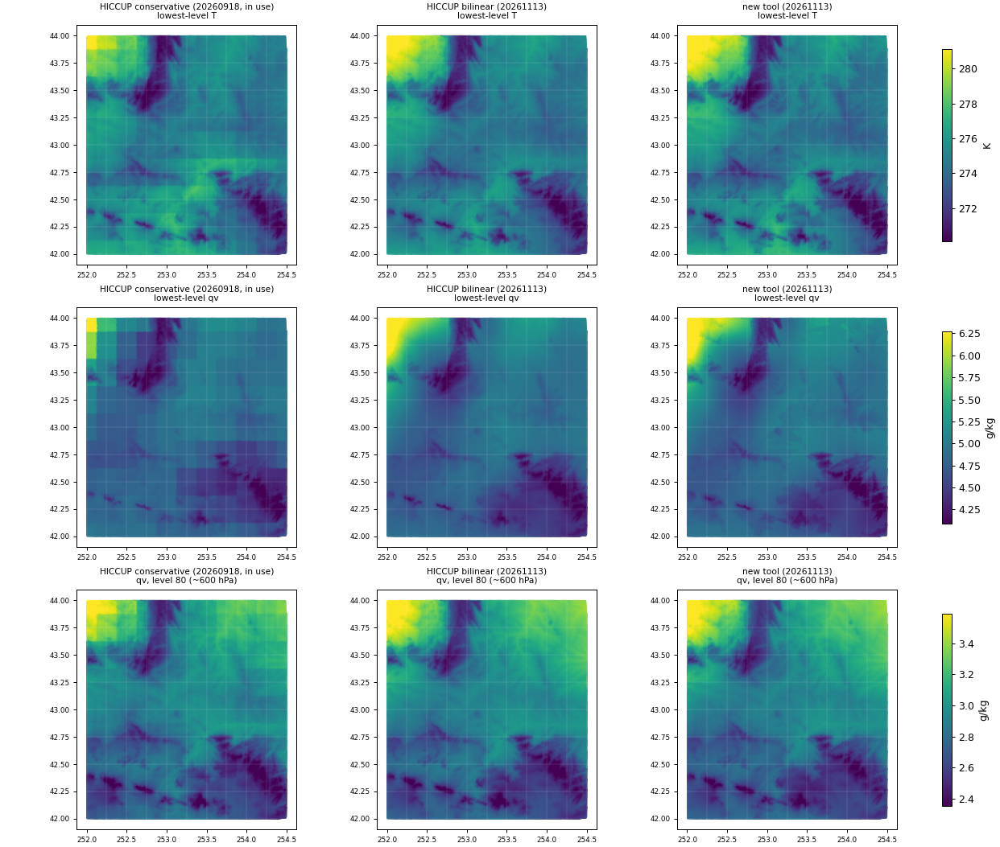
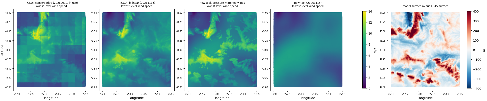

# eamxx-reanalysis-ic compared with HICCUP

This compares the EAMxx initial conditions (ICs) made by this tool with HICCUP's, for the
CONUS 2026 INCITE regionally refined grids (1024x2, 1024x3, 1024x4; np4, L128 E3SMv4 levels)
at 2011-05-19 18Z from ERA5. It sets out how the methods differ, measures the effect of each
difference with the same diagnostics on the same columns, and lists what this tool gives up
or has not yet shown.

Status: 1024x2 is complete. The 1024x3 and 1024x4 sections are filled in when those runs finish.

## Summary

The tool is worth adopting because the ICs are more internally consistent and far cheaper to make.
It is not adopted because they look different. On 1024x2:

- **Hydrostatic consistency is 6× tighter.** This is measured as the 500 hPa height rebuilt from
  the IC's ps, T and qv on the model surface, minus ERA5's analysed z500.
  - Error spread: 0.30 m (new) against 1.9 m (HICCUP bilinear) and 3.9 m (the HICCUP IC in use).
  - Where the model surface is more than 300 m from ERA5's, HICCUP's error is +2.6 to +3.8 m
    with a spread of 5–8 m. The new tool's is −0.5 ± 0.8 m. This is where the surface-pressure
    adjustment matters, and where the two methods differ most.
- **No supersaturation at start-up.** HICCUP leaves up to 101 % relative humidity by EAMxx's own
  formula, in about 0.2 % of points. The cause is a different saturation formula with a
  0.15 K offset. P3 removes the excess on the first step.
- **Upper levels come from analysed data rather than extrapolation.** ERA5's pressure levels stop
  at 1 hPa. The 3 levels of L128 above that are filled by constant extrapolation in HICCUP, which
  makes the top level +6.2 ± 5.2 K warmer than ERA5. The new tool matches ERA5's model levels to
  0.0 ± 0.1 K.
- **Near-surface winds no longer copy the mismatch between model and ERA5 terrain.**
  - With HICCUP, ridges that stand above ERA5's smooth surface get free-atmosphere wind. Over
    Wyoming, the correlation of lowest-level wind speed with model-minus-ERA5 surface height is
    +0.45 (in use) and +0.53 (bilinear). With the new tool it is −0.05, and ERA5's own
    near-surface wind gives −0.07.
  - The cost is a smooth near-surface wind field that EAMxx must develop terrain structure from.
- **Cost:**
  - At x4, 12 h 7 min and 413 GB of memory on one node with HICCUP, against an estimated
    8–10 min with 19 GB per node on 8 nodes.
  - At x2, 2 h 43 min with HICCUP against 7 min 55 s.
  - The new tool restarts from finished chunks and writes no temporary files.
- **What did not change, and why that matters:**
  - **Grid imprinting.** The blocky imprint in the ICs currently in use came from HICCUP's
    conservative map. HICCUP with a bilinear map removes it just as well as this tool does.
    That fix is not a reason to switch tools.
  - **Column water vapour and ps** on matching surfaces agree with ERA5 to within 0.2 % and
    1 Pa in both tools.
- **Different by choice:** the new tool adds ERA5 snow to cloud ice, so column `qi` is 2.8× HICCUP's
  (0.050 against 0.018 kg/m²). See [Condensate](#condensate-snow-in-cloud-ice). `--no-snow-to-ice`
  gives HICCUP's choice.
- **Not yet shown:** no EAMxx simulation has been run from these ICs. The decisive test is a short
  x2 run from each IC, comparing first-hour noise and surface-pressure tendencies. See
  [Validation still needed](#validation-still-needed).

## What was compared

All files are for 2011-05-19 18Z, on the same topography (`USGS-topo_2026-incite-conus-<grid>-np4_smoothedx6t_20251121.nc`,
`PHIS_d`) and the same vertical grid (`L128_for_E3SMv4_c20260820.nc`).

| Label | File | Made with |
|---|---|---|
| HICCUP conservative (in use) | `files_init/HICCUP.atm_era5.2011-05-19.18.<grid>.L128v4.20260918.nc` | HICCUP, ERA5 pressure levels, conservative map (`fv2se_flx`), HICCUP's default ERA5 grid description |
| HICCUP bilinear | `hiccup_x4/output/HICCUP.atm_era5.2011-05-19.18.<grid>.L128v4.20261113.nc` | HICCUP (latest, fc603d6), ERA5 pressure levels, ESMF bilinear map to GLL nodes, ERA5 grid built with exact cell centres |
| new tool, pressure-matched winds | `era5_ic/eamxx_ic.era5-ml...bicubic.pmwind.20261112.nc` (x2 only) | this tool, ERA5 model levels, `--wind-tf-depth 0` |
| new tool | `era5_ic/eamxx_ic.era5-ml...bicubic.20261113.nc` | this tool, ERA5 model levels, defaults |

"HICCUP bilinear" is HICCUP at its best. It uses the latest code, and two corrections were made to
the workflow for this comparison:
- a bilinear map, so there is no imprinting;
- an ERA5 grid description with cell centres on the ERA5 points. HICCUP's default `lat_typ=uni`
  grid misplaces ERA5 by 0.053° of latitude on average over CONUS, and up to 0.085°.

The comparison is therefore between the methods, not against a weakened HICCUP.

## How the methods differ

| Step | HICCUP (as used here) | This tool | Effect |
|---|---|---|---|
| Source data | ERA5 on 37 pressure levels (1000–1 hPa) | ERA5 on its 137 native model levels (surface to 0.01 hPa) | Pressure levels below the ground hold ECMWF-extrapolated values that get interpolated into real columns near steep terrain. Above 1 hPa there is nothing to interpolate. Model levels avoid both. |
| Horizontal interpolation | Precomputed map file (ESMF, 31–69 GB, made on 16 nodes) applied on pressure levels, one variable per file | Weights computed on the fly from the regular lat-lon grid. Bicubic (Keys) for T, ln ps, surface geopotential and winds; bicubic limited to the 2×2 range for q, condensate and O₃. Applied along model levels | Bilinear and bicubic both remove the conservative map's imprinting. Bicubic gives continuous gradients across ERA5 cell edges. On a model-level surface, neighbouring source columns are always above ground. |
| Winds | Interpolated as u and v components | Interpolated as 3D Cartesian vectors, then projected onto local east and north | The same away from the poles. The vector method is correct across the poles. |
| Surface pressure on the model topography | `adjust_surface_pressure` on pressure-level data before the vertical remap. It extrapolates from the 1000 hPa T (itself extrapolated by ECMWF over high terrain) with 6.5 K/km, uses T rather than Tv, and applies one formula for raising and lowering. The Trenberth limits are commented out. | Where the model surface is above ERA5's: ln p interpolated in geopotential within the actual source column, so no lapse rate is assumed. Where it is below: extrapolation at 6.5 K/km from the source surface Tv, capped at 290.5 K (Trenberth et al. 1993). | The main source of the z500 difference where the surfaces disagree (see [Hydrostatic consistency](#hydrostatic-consistency)). |
| T below the source surface | Vertical remap extrapolates at 6.5 K per 100 hPa, independently of the ps adjustment (`adj_T_eam` is off) | Uses the same profile as the ps extrapolation | In HICCUP, ps and T can come from two different assumed profiles. |
| Vertical remap of T and winds | Linear in ln p. Constant above the top source level (1 hPa) | T linear in ln p. Winds at a terrain-following lookup pressure near the ground that blends to pressure matching over the lowest 150 hPa | See [Upper levels](#upper-levels) and [Near-surface winds](#near-surface-winds). |
| Vertical remap of q, condensate and O₃ | Linear in ln p (point values) | Mass-conserving piecewise-linear remap with limited slopes | Both conserve column water vapour well here (see [Moisture](#moisture)). The new method conserves by construction and creates no new extremes. |
| Supersaturation | Clipped to saturation using Bolton (1980) with 273.0 K in place of 273.15 K | Clipped using EAMxx's Murphy–Koop formula, the same as P3 | HICCUP's saturation is about 1 % above EAMxx's, so P3 condenses the excess on the first step. |
| Snow and rain | Not read (`qi` = ERA5 `ciwc` only) | Snow (`cswc`) added to `qi` by default. Rain not written, since EAMxx sets `qr` = 0 | Column `qi` 2.8× HICCUP's. See [Condensate](#condensate-snow-in-cloud-ice). |
| `phis` in the file | ERA5 surface geopotential remapped to the grid | Copied from `PHIS_d` | EAMxx reads `PHIS_d` from the topography file at run time, so the file's `phis` does not reach the model. HICCUP's `phis` differs from the surface the IC was adjusted to (see [Surface geopotential](#surface-geopotential-in-the-file)). |
| Execution | Serial pipeline of file rewrites (xarray/dask, NCO); one node; no restart | One pass per column chunk with numba kernels; MPI-free parallelism across nodes via `srun`; each chunk written once into a CDF5 file; finished chunks skipped on rerun | See [Cost](#cost). |
| Scope | ICs for EAM and EAMxx; SST and sea-ice files; perturbations; ERA5, NOAA and CAMS sources | EAMxx atmosphere ICs only, on np4 grids; ERA5, IFS and MERRA-2 | See [Tradeoffs](#tradeoffs-and-what-this-tool-gives-up). |

## Results on 1024x2

The diagnostics are in [`scripts/ic_diagnostics.py`](scripts/ic_diagnostics.py):
- Columns: the same 30,000 columns (300 random runs of 100) in every file, out of 71,174,684.
- References: ERA5 for the same time. Analysed z500 comes from the pressure-level file (bilinear
  to the nodes); T, q and ps come from the 137 model levels (nearest 0.25° point).
- Physics: EAMxx constants and EAMxx's saturation formula throughout.
- In this sample the model surface is between −345 m and +395 m of ERA5's (1st to 99th percentile).

Full output: [`results/comparison.1024x2.md`](results/comparison.1024x2.md).

| Metric | HICCUP conservative (in use) | HICCUP bilinear | new tool |
|---|---|---|---|
| negative q, qc, qi or O₃ values | 0 | 0 | 0 |
| max RH over liquid (EAMxx formula) | 101.06 % | 101.05 % | 100.00 % |
| points with RH > 100 % (of 3.84M) | 5,983 | 6,633 | 0 |
| file `phis` − `PHIS_d`, rms / max | 152 / 2179 m | 107 / 1419 m | 0 / 0 m |
| z500 error, mean ± std (ps > 700 hPa) | −0.27 ± 3.93 m | −0.15 ± 1.88 m | −0.39 ± 0.30 m |
| z500 error, 99th percentile / max of \|error\| | 13.0 / 31.8 m | 5.0 / 49.3 m | 1.2 / 7.3 m |
| z500 error where surfaces differ > 300 m (618 columns), mean ± std | +2.61 ± 5.24 m | +3.77 ± 8.47 m | −0.54 ± 0.84 m |
| same, max of \|error\| | 31.8 m | 49.3 m | 6.6 m |
| T − ERA5 at the top level (59 Pa), mean ± std | +6.20 ± 5.21 K | +6.28 ± 5.16 K | +0.00 ± 0.08 K |
| T − ERA5 over the 23 levels above 10 hPa, mean ± std | +0.24 ± 2.07 K | +0.28 ± 2.03 K | +0.02 ± 0.30 K |
| column water vapour − ERA5, surfaces within 20 m (22,492 columns) | −0.049 ± 0.823 kg/m² (−0.36 %) | +0.053 ± 0.309 kg/m² (+0.18 %) | −0.001 ± 0.297 kg/m² (+0.01 %) |
| ps − ERA5, surfaces within 20 m | −3.1 ± 66.3 Pa | +0.8 ± 62.3 Pa | +0.6 ± 61.9 Pa |
| mean column qc / qi | 0.056 / 0.018 kg/m² | 0.055 / 0.018 kg/m² | 0.055 / 0.050 kg/m² |

The T, q, ps, z500 and phis rows are identical for the pressure-matched-wind variant of the new
tool, because the wind method changes only U and V.

The spreads in the ERA5-difference rows (T, column water vapour, ps) are mostly the difference
between an interpolated value and the nearest 0.25° ERA5 point. The means are the meaningful part.

### Hydrostatic consistency

The z500 test integrates the hydrostatic equation up from `PHIS_d` (the surface EAMxx uses) through
the IC's own ps, T and qv, and compares the result with ERA5's analysed 500 hPa height. A
consistent IC must reproduce it, because ERA5's z500 comes from the same atmosphere integrated up
from ERA5's own surface. Errors here start the model with a pressure-gradient imbalance that it
removes through gravity waves in the first hours.

- Over all columns the new tool's spread is 0.30 m, against 1.9 m for HICCUP bilinear and 3.9 m for
  the conservative IC in use. The conservative IC's extra spread comes from its blocky horizontal
  interpolation.
- The mean of about −0.4 m in the new tool is a small, uniform bias. It is the same at every
  resolution, and its origin has not been identified. Because it has no horizontal gradient,
  it does not drive any flow. HICCUP's means (−0.15 and −0.27 m) are similar in size.
- The difference is concentrated where the model surface departs from ERA5's. There HICCUP is
  biased by +2.6 to +3.8 m with a 5–8 m spread, and reaches 32–49 m. The new tool stays within 1 m
  (max 6.6 m). Over the Rockies and other steep terrain of the refined region, this is the
  difference that matters. It comes from three choices:
  - HICCUP extrapolates from the 1000 hPa temperature, which over high terrain is ECMWF's own
    extrapolation below ground.
  - HICCUP uses T rather than Tv.
  - HICCUP takes ps and the below-ground T from two different profiles.

  The new tool interpolates within the real source column wherever the model surface is above
  ERA5's, which is about half of the columns over terrain, and uses one profile wherever it must
  extrapolate.
- Part of the improvement comes from using model levels rather than from the algorithm. Run on
  ERA5 pressure levels, the new tool gives −0.3 ± 1.3 m (max 50 m) on 128x2, against −0.4 ± 0.4 m
  (max 16 m) from model levels. With pressure levels, the source column itself is already off
  near steep terrain, because the levels interpolated horizontally include below-ground values.

### Moisture

- **Supersaturation.** Both tools clip to saturation, but against different formulas. HICCUP
  uses Bolton (1980) with T − 273.0 instead of T − 273.15, which gives about 1 % more vapour
  at saturation than EAMxx's Murphy–Koop. P3 therefore sees up to 101 % RH in 0.2 % of points
  and condenses the excess on the first step. This is small, but it is a spurious latent-heat
  source at t = 0. The new tool uses EAMxx's formula, so nothing condenses at start-up.
- **Conservation.** Where the model and ERA5 surfaces agree to within 20 m, column water vapour
  differs from ERA5's by −0.36 % (HICCUP conservative), +0.18 % (HICCUP bilinear) and +0.01 %
  (new tool). HICCUP's linear-in-ln-p remap is not conservative by construction but does well on
  L128. The new remap is conservative by construction. Both are adequate.
- **Positivity.** No file has negative values.

### Condensate: snow in cloud ice

ERA5 carries snow (`cswc`) and rain (`crwc`) as separate prognostic species. P3 has one ice
category that includes snow, and EAMxx sets `qr` = 0 at start-up.
- **HICCUP** drops both snow and rain.
- **This tool** adds snow to `qi` by default, and drops rain like HICCUP.

On 1024x2 the mean column `qi` is 0.050 kg/m² (new) against 0.018 kg/m² (HICCUP). That is the
largest single field difference between the tools, and it is a modelling choice, not an error on
either side:
- **For including snow:** precipitating ice then starts in the model rather than having to form
  again, which is consistent with P3's single category.
- **Against including snow:** snow falls out quickly, and it adds condensate that EAMxx's
  macrophysics did not produce.

`--no-snow-to-ice` gives HICCUP's choice. Decide this for the CONUS runs on purpose rather than
by default.

### Upper levels

L128 has 3 levels above 1 hPa (the top mid-level is at 59 Pa) and 23 above 10 hPa.
- **HICCUP:** ERA5 pressure levels stop at 1 hPa, so HICCUP holds every field constant at its
  1 hPa value above that. The top level is therefore 6.2 ± 5.2 K too warm.
- **New tool:** ERA5 model levels reach 0.01 hPa, so it interpolates analysed values and
  matches ERA5 to 0.0 ± 0.1 K.

This matters little for a few-day weather run, because these levels sit in the model's sponge
layer. It is still an error HICCUP introduces with this source, and in the new tool it is absent.

### Surface geopotential in the file

HICCUP writes ERA5's surface geopotential, remapped, as `phis`. On 1024x2 that differs from the
surface the IC was adjusted to (`PHIS_d`) by 107–152 m rms and up to 2.2 km. EAMxx ignores the
file's `phis` and reads `PHIS_d` from the topography file, so the model is not affected. Any
diagnostic computed from HICCUP's IC file alone is affected, though: heights, sea-level pressure,
or a hydrostatic check like the one above. The new tool writes `PHIS_d`, so the file is
self-consistent.

### Grid imprinting



The CONUS x2 and x3 runs showed grid-scale noise that was traced to blocky ICs. The left column
shows the cause: the conservative map copies each 0.25° ERA5 cell value to every node inside it.
HICCUP with a bilinear map (middle) and the new tool (right) both remove this, and they are
visually indistinguishable in T and q. The fix comes from the map choice, and HICCUP alone would
have delivered it.

A neighbour-roughness metric (in `terrain_metrics.py`) does not separate the two. It scores the
new tool's lowest-level T higher than HICCUP bilinear's (0.048 against 0.039 K). That reflects
real terrain-driven variation: model levels resolve the strong midday near-surface lapse rate,
which then varies with the 1 km terrain. It is not imprinting. Treat the maps as the evidence
here.

### Near-surface winds



| Lowest model level, Wyoming box (68,536 columns) | corr(speed, surface-height mismatch) | speed where model is ≥ 50 m below ERA5 | within 20 m | ≥ 100 m above |
|---|---|---|---|---|
| ERA5's own lowest model level (~10 m), interpolated | −0.07 | 5.3 | 5.9 | 4.8 m/s |
| HICCUP conservative (in use) | +0.45 | 5.6 | 6.5 | 7.7 |
| HICCUP bilinear | +0.53 | 5.7 | 7.0 | 8.2 |
| new tool, pressure-matched winds | +0.58 | 5.3 | 6.5 | 8.5 |
| new tool (terrain-following near the ground) | −0.05 | 5.4 | 6.1 | 4.9 |

Matching winds by pressure has a side effect. A model ridge that stands 300 m above ERA5's
smoothed surface sits at a pressure where ERA5 has free-atmosphere wind, so it gets that wind;
a valley below ERA5's surface gets ERA5's lowest wind. Lowest-level wind speed then maps the
*difference between two terrains*: correlation +0.45 to +0.58 with that difference, and
ridge-top winds 60–80 % faster than ERA5's near-surface wind. ERA5 itself shows no such
relation (−0.07), because it never sees the model terrain.
- Model-level input makes this sharper (+0.58), because it resolves ERA5's surface layer. The
  shear between ERA5's 10 m and 300 m winds is then larger than pressure levels can show.
- With terrain-following lookup near the ground (the same p/ps as the target level, blending to
  pressure matching over the lowest 150 hPa), every column's lowest level takes ERA5's
  near-surface wind. The correlation drops to −0.05.

Two cautions:
- **Closeness to ERA5 is partly by construction.** The terrain-following method samples ERA5
  near its surface on purpose, so it reproducing ERA5's lowest-level wind proves nothing by
  itself. The argument for it is physical: whether a 1 km ridge gets free-atmosphere wind should
  not be decided by how far a 30 km reanalysis surface happens to sit below it.
- **The result is smooth.** ERA5 has no information about km-scale ridges and valleys, so the
  new IC's near-surface wind has almost no terrain structure (U roughness 0.005 against 0.04–0.08
  m/s for the others). Real ridge-top winds are faster than valley winds, so EAMxx has to
  develop that structure, probably within the first hour. The structure in the
  pressure-matched fields is not that physics either: it is ERA5's vertical wind profile placed
  at the wrong heights. A smooth field is the honest starting point, but it does mean starting
  without terrain influence near the surface.

The old behaviour remains available with `--wind-tf-depth 0`.

### Cost

| Grid (columns) | HICCUP bilinear, IC step | HICCUP map step | new tool |
|---|---|---|---|
| 1024x2 (71.2M) | 2 h 43 min, 207 GB peak, 1 node | 16 nodes, 31–69 GB/node, minutes | 7 min 55 s on 8 nodes (1 min 50 s of column work), 18.8 GB/node |
| 1024x3 (117.2M) | 4 h 29 min, 202 GB peak, 1 node | as above | pending |
| 1024x4 (300.0M) | 12 h 7 min, 413 GB peak, 1 node | as above | pending (estimated 8–10 min) |

- **Memory.** The new tool's memory is set by the source data held in each task (the 137-level
  ERA5 fields), not by the grid, so it does not grow with resolution.
- **HICCUP's steps.** At x4, combining the per-variable temporary files took 4 h and the state
  adjustment 1 h. The earlier HICCUP x4 run (the 20260918 file) took more than a day, with over
  650 GB of temporary files.
- **Restarts.** HICCUP cannot resume: a failure at hour 11 means starting over. The new tool
  skips finished chunks.
- **Data cost.** ERA5 model levels for one time are 2.0 GB of GRIB, against 0.43 GB of pressure
  levels. They come from the tape-backed MARS archive through CDS, which took hours of queueing
  for this request. Pressure-level requests are typically much faster.

## Results on 1024x3 and 1024x4

Pending: new-tool jobs 61220847 (x3) and 61220848 (x4) are queued. The same diagnostics will be
run against HICCUP conservative (in use) and HICCUP bilinear at each resolution.

## Tradeoffs: what this tool gives up

- **Maturity and maintenance.** HICCUP is an E3SM-project tool with many users and a history of
  bugs found and fixed. This tool is new, has one author, and has been tested on one date and
  one family of grids. Its unit tests check the numerics against analytic answers (13 tests), and
  `check` validates each output, but that is not the same as wide use.
- **Scope.**
  - The tool makes EAMxx atmosphere ICs on np4 grids only. HICCUP also makes SST and sea-ice
    files, adds perturbations for ensembles, targets EAM as well as EAMxx, and reads NOAA and
    CAMS data.
  - The CONUS workflow still needs HICCUP, or something else, for SST and sea ice.
- **Copied physics.** The tool copies EAMxx's constants and saturation formula rather than
  linking to EAMxx. A change in EAMxx would not be picked up automatically. A drift test is listed
  under future considerations in the README.
- **Data access.**
  - Model-level ERA5 is slower to obtain (see Cost).
  - The IFS route needs MARS access.
  - The MERRA-2 model-level route needs an Earthdata login.
  - Pressure-level input still works, with the steep-terrain limits described above.
- **Unlimited bicubic for T and winds.** Bicubic interpolation can overshoot the surrounding
  source values slightly (moisture, condensate and O₃ are limited, T and winds are not). At 0.25°
  source resolution and smooth analysed fields this is small, but it is a new behaviour.
- **Not comparable with earlier runs.** CONUS runs started from the 20260918 HICCUP ICs differ from
  new runs by more than just the IC tool. That matters only if results are compared across that
  boundary.
- **Smooth near-surface winds** (see above). This is a deliberate choice with a spin-up cost.

## Validation still needed

None of the above shows that EAMxx runs better from these ICs; it shows that they are more
consistent. The decisive test is cheap at x2:

1. Run 2–6 h at 1024x2 from the HICCUP bilinear IC and from the new IC, with the same settings.
2. Compare the first-hour domain-mean |dps/dt| (gravity-wave noise from hydrostatic imbalance),
   grid-scale variance of near-surface fields over the Rockies, the first-step condensation, and
   the near-surface wind spin-up over ridges.
3. If the wind spin-up looks slow or unphysical, rerun with `--wind-tf-depth 0` for comparison.
   That rerun takes minutes.

## Reproducing

```bash
GRID=1024x2 TOOL_DIR=$PWD sbatch --account=e3sm --export=ALL docs/scripts/run_comparison.sh
```

`run_comparison.sh` runs three scripts and holds the Perlmutter paths of every file named here:
- `ic_diagnostics.py`: the table above
- `terrain_metrics.py`: the Wyoming roughness and wind table, and the wind figure
- `imprint_maps.py`: the imprinting figure

Each script works on any set of IC files on the same grid.
