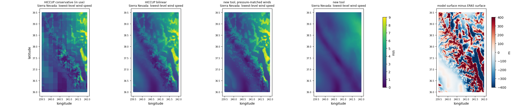
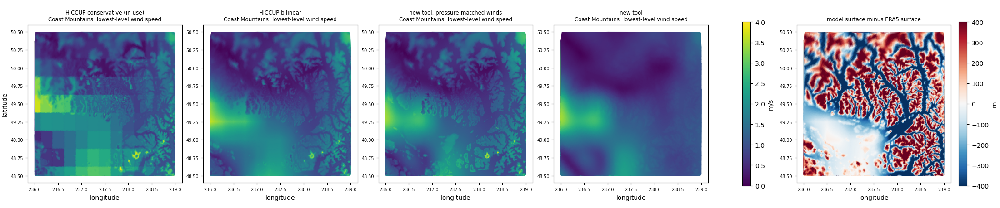
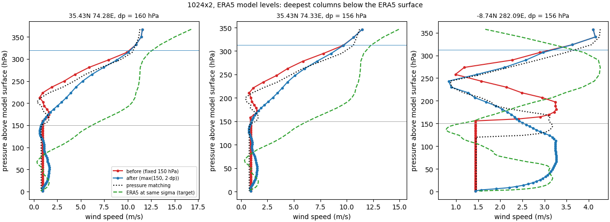
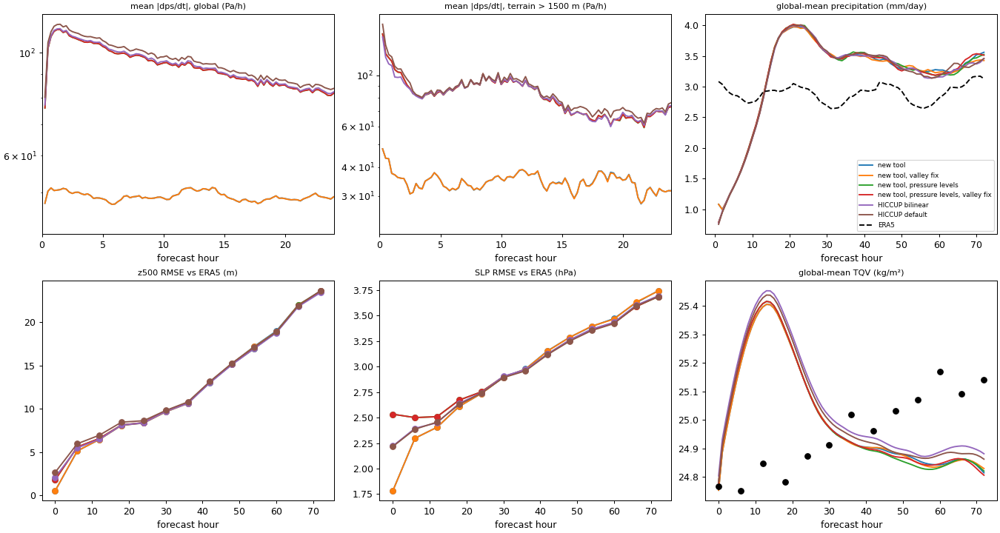

# eamxx-reanalysis-ic compared with HICCUP

This compares the EAMxx initial conditions (ICs) made by this tool with HICCUP's, for the
CONUS 2026 INCITE regionally refined grids (1024x2, 1024x3, 1024x4; np4, L128 E3SMv4 levels)
at 2011-05-19 18Z from ERA5. It sets out how the methods differ, measures the effect of each
difference with the same diagnostics on the same columns, and lists what this tool gives up
or has not yet shown.

Status:
- IC diagnostics complete for 1024x2, 1024x3 and 1024x4.
- Uniform ne30, ne120 and ne256 grids, with the new tool also run on ERA5 pressure levels to
  separate method from input data ([Uniform grids](#uniform-grids-ne30-ne120-ne256)).
- A fix for wind folding in deep valleys (a4229bf), with a before/after comparison on every grid
  ([Deep-valley wind fix](#deep-valley-wind-fix)).
- 3-day EAMxx runs at ne30 and ne120 from each IC ([EAMxx test runs](#eamxx-test-runs-ne30-and-ne120)).

Current files carry the tag `20261113b` (with the fix). The `20261113` files (without it) are kept
for comparison. The tables before the deep-valley section were computed on the `20261113` files.
The fix changes only U and V, and only in columns where the model surface is more than 75 hPa
below ERA5's, which is at most 0.4 % of any grid's columns. Every other row is bit-identical.

## Summary

The tool is worth adopting because the ICs are more internally consistent and far cheaper to make.
It is not adopted because they look different. On 1024x2:

- **Hydrostatic consistency is 6× tighter.** This is measured as the 500 hPa height rebuilt from
  the IC's ps, T and qv on the model surface, minus ERA5's analysed z500.
  - Error spread: 0.30 m (new) against 1.9 m (HICCUP bilinear) and 3.9 m (the HICCUP IC in use).
  - Where the model surface is more than 300 m from ERA5's, HICCUP's error is +2.6 to +3.8 m
    with a spread of 5–8 m. The new tool's is −0.5 ± 0.8 m. This is where the surface-pressure
    adjustment matters, and where the two methods differ most.
- **No supersaturation at start-up.** HICCUP leaves up to 101 % relative humidity by EAMxx's own
  formula, in about 0.2 % of points. The cause is a different saturation formula with a
  0.15 K offset. P3 removes the excess on the first step.
- **Upper levels come from analysed data rather than extrapolation.** ERA5's pressure levels stop
  at 1 hPa. The 3 levels of L128 above that are filled by constant extrapolation in HICCUP, which
  makes the top level +6.2 ± 5.2 K warmer than ERA5. The new tool matches ERA5's model levels to
  0.0 ± 0.1 K.
- **Near-surface winds no longer copy the mismatch between model and ERA5 terrain.**
  - With HICCUP, ridges that stand above ERA5's smooth surface get free-atmosphere wind. Over
    Wyoming, the correlation of lowest-level wind speed with model-minus-ERA5 surface height is
    +0.45 (in use) and +0.53 (bilinear). With the new tool it is −0.05, and ERA5's own
    near-surface wind gives −0.07. The Sierra Nevada (+0.39 to +0.41 against −0.01) and the
    Coast Mountains (+0.20 to +0.26 against −0.03) show the same pattern.
  - The cost is a smooth near-surface wind field that EAMxx must develop terrain structure from.
- **Cost:**
  - At x4, 12 h 7 min and 413 GB of memory on one node with HICCUP, against 30 min on 8 nodes
    (6.6 min of column work, 145 GB per node).
  - At x2, 2 h 43 min with HICCUP against 7 min 55 s.
  - The new tool restarts from finished chunks and writes no temporary files.
- **What did not change, and why that matters:**
  - **Grid imprinting.** The blocky imprint in the ICs currently in use came from HICCUP's
    conservative map. HICCUP with a bilinear map removes it just as well as this tool does.
    That fix is not a reason to switch tools.
  - **Column water vapour and ps** on matching surfaces agree with ERA5 to within 0.2 % and
    1 Pa in both tools.
- **Different by choice:** the new tool adds ERA5 snow to cloud ice, so column `qi` is 2.8× HICCUP's
  (0.050 against 0.018 kg/m²). See [Condensate](#condensate-snow-in-cloud-ice). `--no-snow-to-ice`
  gives HICCUP's choice.
- **Method or input data?** Running the new tool on the same ERA5 pressure levels HICCUP reads
  (uniform grids) separates the two:
  - From the method: no supersaturation, `phis` consistent with the model surface, and part of
    the hydrostatic gain (z500 spread 1.9 → 1.3–1.5 m).
  - From the model-level input: most of the hydrostatic gain (1.3–1.5 → 0.3–0.5 m), the
    upper levels (the +5.6 K top-level error is identical with pressure-level input in either
    tool), and realistic near-surface winds where the model surface is below ERA5's.
- **In EAMxx (3-day uniform-grid runs, only the IC differs):**
  - The model-level ICs start with the smallest surface-pressure tendencies, and the gap lasts
    the whole run.
    - ne30, first step: global / high-terrain mean |dps/dt| of 47 / 52 Pa/h, against 55 / 84
      (HICCUP bilinear) and 70 / 185 (HICCUP default).
    - ne120: 47 / 48 Pa/h against 76–80 / 147–167 for all three pressure-level ICs.
  - The new tool on pressure levels behaves like HICCUP, so this comes from the input data.
  - Forecast error against ERA5 starts lower (z500 RMSE at 0 h: 0.5 against 1.8–2.6 m at ne120).
    By 6–12 h, all ICs reach the same error, and they stay together to 72 h.
  - Snow in cloud ice falls out on the first step: global precipitation is 1.3 against 0.15–0.2 mm/day.
  - See [EAMxx test runs](#eamxx-test-runs-ne30-and-ne120).
- **A fix for deep valleys.** The terrain-following wind blending folded where the model surface
  lies more than about 125 hPa below ERA5's, which gave a constant wind through the blending layer.
  This affected 1,761 columns at x4, 1,514 of them in the Cascades and Sierra Nevada. The blending
  depth now grows with the depth of the valley. Wind error against ERA5 in those columns:
  2.2 → 1.6 m/s RMS at x2. No other field and no other column changes. See
  [Deep-valley wind fix](#deep-valley-wind-fix).
- **Not yet shown:** a run on the CONUS grids themselves. See
  [Validation still needed](#validation-still-needed).

## What was compared

All files are for 2011-05-19 18Z, on the same topography (`USGS-topo_2026-incite-conus-<grid>-np4_smoothedx6t_20251121.nc`,
`PHIS_d`) and the same vertical grid (`L128_for_E3SMv4_c20260820.nc`).

| Label | File | Made with |
|---|---|---|
| HICCUP conservative (in use) | `files_init/HICCUP.atm_era5.2011-05-19.18.<grid>.L128v4.20260918.nc` | HICCUP, ERA5 pressure levels, conservative map (`fv2se_flx`), HICCUP's default ERA5 grid description |
| HICCUP bilinear | `hiccup_x4/output/HICCUP.atm_era5.2011-05-19.18.<grid>.L128v4.20261113.nc` | HICCUP (latest, fc603d6), ERA5 pressure levels, ESMF bilinear map to GLL nodes, ERA5 grid built with exact cell centres |
| new tool, pressure-matched winds | `era5_ic/eamxx_ic.era5-ml...bicubic.pmwind.20261112.nc` (x2 only) | this tool, ERA5 model levels, `--wind-tf-depth 0` |
| new tool | `era5_ic/eamxx_ic.era5-ml...bicubic.20261113.nc` | this tool, ERA5 model levels, defaults (before the deep-valley fix; the fixed files are `...bicubic.20261113b.nc`) |

"HICCUP bilinear" is HICCUP at its best. It uses the latest code, and two corrections were made to
the workflow for this comparison:
- a bilinear map, so there is no imprinting;
- an ERA5 grid description with cell centres on the ERA5 points. HICCUP's default `lat_typ=uni`
  grid misplaces ERA5 by 0.053° of latitude on average over CONUS, and up to 0.085°.

The comparison is therefore between the methods, not against a weakened HICCUP.

## How the methods differ

| Step | HICCUP (as used here) | This tool | Effect |
|---|---|---|---|
| Source data | ERA5 on 37 pressure levels (1000–1 hPa) | ERA5 on its 137 native model levels (surface to 0.01 hPa) | Pressure levels below the ground hold ECMWF-extrapolated values that get interpolated into real columns near steep terrain. Above 1 hPa there is nothing to interpolate. Model levels avoid both. |
| Horizontal interpolation | Precomputed map file (ESMF, 31–69 GB, made on 16 nodes) applied on pressure levels, one variable per file | Weights computed on the fly from the regular lat-lon grid. Bicubic (Keys) for T, ln ps, surface geopotential and winds; bicubic limited to the 2×2 range for q, condensate and O₃. Applied along model levels | Bilinear and bicubic both remove the conservative map's imprinting. Bicubic gives continuous gradients across ERA5 cell edges. On a model-level surface, neighbouring source columns are always above ground. |
| Winds | Interpolated as u and v components | Interpolated as 3D Cartesian vectors, then projected onto local east and north | The same away from the poles. The vector method is correct across the poles. |
| Surface pressure on the model topography | `adjust_surface_pressure` on pressure-level data before the vertical remap. It extrapolates from the 1000 hPa T (itself extrapolated by ECMWF over high terrain) with 6.5 K/km, uses T rather than Tv, and applies one formula for raising and lowering. The Trenberth limits are commented out. | Where the model surface is above ERA5's: ln p interpolated in geopotential within the actual source column, so no lapse rate is assumed. Where it is below: extrapolation at 6.5 K/km from the source surface Tv, capped at 290.5 K (Trenberth et al. 1993). | The main source of the z500 difference where the surfaces disagree (see [Hydrostatic consistency](#hydrostatic-consistency)). |
| T below the source surface | Vertical remap extrapolates at 6.5 K per 100 hPa, independently of the ps adjustment (`adj_T_eam` is off) | Uses the same profile as the ps extrapolation | In HICCUP, ps and T can come from two different assumed profiles. |
| Vertical remap of T and winds | Linear in ln p. Constant above the top source level (1 hPa) | T linear in ln p. Winds at a terrain-following lookup pressure near the ground that blends to pressure matching over the lowest 150 hPa, or over twice the surface-pressure difference in deep valleys | See [Upper levels](#upper-levels) and [Near-surface winds](#near-surface-winds). |
| Vertical remap of q, condensate and O₃ | Linear in ln p (point values) | Mass-conserving piecewise-linear remap with limited slopes | Both conserve column water vapour well here (see [Moisture](#moisture)). The new method conserves by construction and creates no new extremes. |
| Supersaturation | Clipped to saturation using Bolton (1980) with 273.0 K in place of 273.15 K | Clipped using EAMxx's Murphy–Koop formula, the same as P3 | HICCUP's saturation is about 1 % above EAMxx's, so P3 condenses the excess on the first step. |
| Snow and rain | Not read (`qi` = ERA5 `ciwc` only) | Snow (`cswc`) added to `qi` by default. Rain not written, since EAMxx sets `qr` = 0 | Column `qi` 2.8× HICCUP's. See [Condensate](#condensate-snow-in-cloud-ice). |
| `phis` in the file | ERA5 surface geopotential remapped to the grid | Copied from `PHIS_d` | EAMxx reads `PHIS_d` from the topography file at run time, so the file's `phis` does not reach the model. HICCUP's `phis` differs from the surface the IC was adjusted to (see [Surface geopotential](#surface-geopotential-in-the-file)). |
| Execution | Serial pipeline of file rewrites (xarray/dask, NCO); one node; no restart | One pass per column chunk with numba kernels; MPI-free parallelism across nodes via `srun`; each chunk written once into a CDF5 file; finished chunks skipped on rerun | See [Cost](#cost). |
| Scope | ICs for EAM and EAMxx; SST and sea-ice files; perturbations; ERA5, NOAA and CAMS sources | EAMxx atmosphere ICs only, on np4 grids; ERA5, IFS and MERRA-2 | See [Tradeoffs](#tradeoffs-what-this-tool-gives-up). |

## Results on 1024x2

The diagnostics are in [`scripts/ic_diagnostics.py`](scripts/ic_diagnostics.py):
- Columns: the same 30,000 columns (300 random runs of 100) in every file, out of 71,174,684.
- References: ERA5 for the same time. Analysed z500 comes from the pressure-level file (bilinear
  to the nodes); T, q and ps come from the 137 model levels (nearest 0.25° point).
- Physics: EAMxx constants and EAMxx's saturation formula throughout.
- In this sample the model surface is between −345 m and +395 m of ERA5's (1st to 99th percentile).

Full output: [`results/comparison.1024x2.md`](results/comparison.1024x2.md).

| Metric | HICCUP conservative (in use) | HICCUP bilinear | new tool |
|---|---|---|---|
| negative q, qc, qi or O₃ values | 0 | 0 | 0 |
| max RH over liquid (EAMxx formula) | 101.06 % | 101.05 % | 100.00 % |
| points with RH > 100 % (of 3.84M) | 5,983 | 6,633 | 0 |
| file `phis` − `PHIS_d`, rms / max | 152 / 2179 m | 107 / 1419 m | 0 / 0 m |
| z500 error, mean ± std (ps > 700 hPa) | −0.27 ± 3.93 m | −0.15 ± 1.88 m | −0.39 ± 0.30 m |
| z500 error, 99th percentile / max of \|error\| | 13.0 / 31.8 m | 5.0 / 49.3 m | 1.2 / 7.3 m |
| z500 error where surfaces differ > 300 m (618 columns), mean ± std | +2.61 ± 5.24 m | +3.77 ± 8.47 m | −0.54 ± 0.84 m |
| same, max of \|error\| | 31.8 m | 49.3 m | 6.6 m |
| T − ERA5 at the top level (59 Pa), mean ± std | +6.20 ± 5.21 K | +6.28 ± 5.16 K | +0.00 ± 0.08 K |
| T − ERA5 over the 23 levels above 10 hPa, mean ± std | +0.24 ± 2.07 K | +0.28 ± 2.03 K | +0.02 ± 0.30 K |
| column water vapour − ERA5, surfaces within 20 m (22,492 columns) | −0.049 ± 0.823 kg/m² (−0.36 %) | +0.053 ± 0.309 kg/m² (+0.18 %) | −0.001 ± 0.297 kg/m² (+0.01 %) |
| ps − ERA5, surfaces within 20 m | −3.1 ± 66.3 Pa | +0.8 ± 62.3 Pa | +0.6 ± 61.9 Pa |
| mean column qc / qi | 0.056 / 0.018 kg/m² | 0.055 / 0.018 kg/m² | 0.055 / 0.050 kg/m² |

The T, q, ps, z500 and phis rows are identical for the pressure-matched-wind variant of the new
tool, because the wind method changes only U and V.

The spreads in the ERA5-difference rows (T, column water vapour, ps) are mostly the difference
between an interpolated value and the nearest 0.25° ERA5 point. The means are the meaningful part.

### Hydrostatic consistency

The z500 test integrates the hydrostatic equation up from `PHIS_d` (the surface EAMxx uses) through
the IC's own ps, T and qv, and compares the result with ERA5's analysed 500 hPa height. A
consistent IC must reproduce it, because ERA5's z500 comes from the same atmosphere integrated up
from ERA5's own surface. Errors here start the model with a pressure-gradient imbalance that it
removes through gravity waves in the first hours.

- Over all columns the new tool's spread is 0.30 m, against 1.9 m for HICCUP bilinear and 3.9 m for
  the conservative IC in use. The conservative IC's extra spread comes from its blocky horizontal
  interpolation.
- The mean of about −0.4 m in the new tool is a small, uniform bias. It is the same at every
  resolution, and its origin has not been identified. Because it has no horizontal gradient,
  it does not drive any flow. HICCUP's means (−0.15 and −0.27 m) are similar in size.
- The difference is concentrated where the model surface departs from ERA5's. There HICCUP is
  biased by +2.6 to +3.8 m with a 5–8 m spread, and reaches 32–49 m. The new tool stays within 1 m
  (max 6.6 m). Over the Rockies and other steep terrain of the refined region, this is the
  difference that matters. It comes from three choices:
  - HICCUP extrapolates from the 1000 hPa temperature, which over high terrain is ECMWF's own
    extrapolation below ground.
  - HICCUP uses T rather than Tv.
  - HICCUP takes ps and the below-ground T from two different profiles.

  The new tool interpolates within the real source column wherever the model surface is above
  ERA5's, which is about half of the columns over terrain, and uses one profile wherever it must
  extrapolate.
- Part of the improvement comes from using model levels rather than from the algorithm. Run on
  ERA5 pressure levels, the new tool gives −0.3 ± 1.3 m (max 50 m) on 128x2, against −0.4 ± 0.4 m
  (max 16 m) from model levels. With pressure levels, the source column itself is already off
  near steep terrain, because the levels interpolated horizontally include below-ground values.

### Moisture

- **Supersaturation.** Both tools clip to saturation, but against different formulas. HICCUP
  uses Bolton (1980) with T − 273.0 instead of T − 273.15, which gives about 1 % more vapour
  at saturation than EAMxx's Murphy–Koop. P3 therefore sees up to 101 % RH in 0.2 % of points
  and condenses the excess on the first step. This is small, but it is a spurious latent-heat
  source at t = 0. The new tool uses EAMxx's formula, so nothing condenses at start-up.
- **Conservation.** Where the model and ERA5 surfaces agree to within 20 m, column water vapour
  differs from ERA5's by −0.36 % (HICCUP conservative), +0.18 % (HICCUP bilinear) and +0.01 %
  (new tool). HICCUP's linear-in-ln-p remap is not conservative by construction but does well on
  L128. The new remap is conservative by construction. Both are adequate.
- **Positivity.** No file has negative values.

### Condensate: snow in cloud ice

ERA5 carries snow (`cswc`) and rain (`crwc`) as separate prognostic species. P3 has one ice
category that includes snow, and EAMxx sets `qr` = 0 at start-up.
- **HICCUP** drops both snow and rain.
- **This tool** adds snow to `qi` by default, and drops rain like HICCUP.

On 1024x2 the mean column `qi` is 0.050 kg/m² (new) against 0.018 kg/m² (HICCUP). That is the
largest single field difference between the tools, and it is a modelling choice, not an error on
either side:
- **For including snow:** precipitating ice then starts in the model rather than having to form
  again, which is consistent with P3's single category.
- **Against including snow:** snow falls out quickly, and it adds condensate that EAMxx's
  macrophysics did not produce.

`--no-snow-to-ice` gives HICCUP's choice. Decide this for the CONUS runs on purpose rather than
by default.

### Upper levels

L128 has 3 levels above 1 hPa (the top mid-level is at 59 Pa) and 23 above 10 hPa.
- **HICCUP:** ERA5 pressure levels stop at 1 hPa, so HICCUP holds every field constant at its
  1 hPa value above that. The top level is therefore 6.2 ± 5.2 K too warm.
- **New tool:** ERA5 model levels reach 0.01 hPa, so it interpolates analysed values and
  matches ERA5 to 0.0 ± 0.1 K.

This matters little for a few-day weather run, because these levels sit in the model's sponge
layer. It is still an error HICCUP introduces with this source, and in the new tool it is absent.

### Surface geopotential in the file

HICCUP writes ERA5's surface geopotential, remapped, as `phis`. On 1024x2 that differs from the
surface the IC was adjusted to (`PHIS_d`) by 107–152 m rms and up to 2.2 km. EAMxx ignores the
file's `phis` and reads `PHIS_d` from the topography file, so the model is not affected. Any
diagnostic computed from HICCUP's IC file alone is affected, though: heights, sea-level pressure,
or a hydrostatic check like the one above. The new tool writes `PHIS_d`, so the file is
self-consistent.

### Grid imprinting


The CONUS x2 and x3 runs showed grid-scale noise that was traced to blocky ICs. The left column
shows the cause: the conservative map copies each 0.25° ERA5 cell value to every node inside it.
HICCUP with a bilinear map (middle) and the new tool (right) both remove this, and they are
visually indistinguishable in T and q. The fix comes from the map choice, and HICCUP alone would
have delivered it.

A neighbour-roughness metric (in `terrain_metrics.py`) does not separate the two. It scores the
new tool's lowest-level T higher than HICCUP bilinear's (0.048 against 0.039 K). That reflects
real terrain-driven variation: model levels resolve the strong midday near-surface lapse rate,
which then varies with the 1 km terrain. It is not imprinting. Treat the maps as the evidence
here.

### Near-surface winds


| Lowest model level, Wyoming box (68,536 columns) | corr(speed, surface-height mismatch) | speed where model is ≥ 50 m below ERA5 | within 20 m | ≥ 100 m above |
|---|---|---|---|---|
| ERA5's own lowest model level (~10 m), interpolated | −0.07 | 5.3 | 5.9 | 4.8 m/s |
| HICCUP conservative (in use) | +0.45 | 5.6 | 6.5 | 7.7 |
| HICCUP bilinear | +0.53 | 5.7 | 7.0 | 8.2 |
| new tool, pressure-matched winds | +0.58 | 5.3 | 6.5 | 8.5 |
| new tool (terrain-following near the ground) | −0.05 | 5.4 | 6.1 | 4.9 |

Matching winds by pressure has a side effect. A model ridge that stands 300 m above ERA5's
smoothed surface sits at a pressure where ERA5 has free-atmosphere wind, so it gets that wind;
a valley below ERA5's surface gets ERA5's lowest wind. Lowest-level wind speed then maps the
*difference between two terrains*: correlation +0.45 to +0.58 with that difference, and
ridge-top winds 60–80 % faster than ERA5's near-surface wind. ERA5 itself shows no such
relation (−0.07), because it never sees the model terrain.
- Model-level input makes this sharper (+0.58), because it resolves ERA5's surface layer. The
  shear between ERA5's 10 m and 300 m winds is then larger than pressure levels can show.
- With terrain-following lookup near the ground (the same p/ps as the target level, blending to
  pressure matching over the lowest 150 hPa), every column's lowest level takes ERA5's
  near-surface wind. The correlation drops to −0.05.

Two cautions:
- **Closeness to ERA5 is partly by construction.** The terrain-following method samples ERA5
  near its surface on purpose, so it reproducing ERA5's lowest-level wind proves nothing by
  itself. The argument for it is physical: whether a 1 km ridge gets free-atmosphere wind should
  not be decided by how far a 30 km reanalysis surface happens to sit below it.
- **The result is smooth.** ERA5 has no information about km-scale ridges and valleys, so the
  new IC's near-surface wind has almost no terrain structure (U roughness 0.005 against 0.04–0.08
  m/s for the others). Real ridge-top winds are faster than valley winds, so EAMxx has to
  develop that structure, probably within the first hour. The structure in the
  pressure-matched fields is not that physics either: it is ERA5's vertical wind profile placed
  at the wrong heights. A smooth field is the honest starting point, but it does mean starting
  without terrain influence near the surface.

The old behaviour remains available with `--wind-tf-depth 0`. The figures and tables in this section
were computed before the [deep-valley fix](#deep-valley-wind-fix). The fix changes no column in the
Wyoming box. It changes a few thousand of the deepest valley columns in the Sierra and Coast Mountains,
so the wind statistics there would shift slightly. The hydrostatic statistics would not.

### Steep terrain: Sierra Nevada and Coast Mountains

Wyoming was used above because it is where the grid-scale noise in the x2 and x3 runs was first
traced (`analysis/noise_zoom.py` in conus200). It is moderate terrain: the model surface is
between −190 m and +300 m of ERA5's (5th to 95th percentile). Two steeper regions test the
surface-pressure adjustment and the winds harder:
- **Sierra Nevada**, 36–39.5N, 118–120.5W: −540 to +610 m.
- **Coast Mountains around the x3 crash site**, 48.5–50.5N, 121–124W: −650 to +530 m.

The script is the same (`terrain_metrics.py` with `BOX`, plus the hydrostatic check over the
box). Here the hydrostatic check uses every column in the box rather than a sample: 500 hPa where
ps > 700 hPa, and 300 hPa everywhere, because 300 hPa is above the ground in every column.
Full output: [`results/regions.md`](results/regions.md).

| Region (grid) | IC | z500 error, mean ± std (max) | z300 error, mean ± std (max) | corr(wind, dz) |
|---|---|---|---|---|
| Wyoming (x2) | HICCUP conservative (in use) | −2.7 ± 2.3 (10) m | −8.2 ± 3.6 (18) m | +0.45 |
| | HICCUP bilinear | +1.4 ± 1.0 (8) m | +1.2 ± 1.5 (7) m | +0.53 |
| | new tool | +0.4 ± 0.5 (3) m | +0.5 ± 0.5 (4) m | −0.05 |
| Sierra Nevada (x2) | HICCUP conservative (in use) | +2.6 ± 6.3 (47) m | +8.6 ± 8.2 (61) m | +0.41 |
| | HICCUP bilinear | +4.8 ± 7.3 (46) m | +6.3 ± 7.3 (45) m | +0.39 |
| | new tool | −0.7 ± 1.0 (6) m | −0.8 ± 0.8 (5) m | −0.01 |
| Coast Mountains (x2) | HICCUP conservative (in use) | +0.9 ± 2.0 (10) m | +4.8 ± 3.3 (20) m | +0.21 |
| | HICCUP bilinear | +1.9 ± 2.0 (9) m | +1.7 ± 2.0 (8) m | +0.20 |
| | new tool | −0.7 ± 0.4 (2) m | −0.9 ± 0.3 (2) m | −0.03 |
| Coast Mountains (x3) | HICCUP conservative (in use) | +0.9 ± 2.0 (11) m | +4.8 ± 3.3 (20) m | +0.25 |
| | HICCUP bilinear | +1.9 ± 2.0 (9) m | +1.7 ± 2.0 (9) m | +0.23 |
| | new tool | −0.7 ± 0.4 (2) m | −0.9 ± 0.3 (2) m | −0.02 |

ERA5's own near-surface wind gives a correlation of −0.04 to −0.07 in every region.

- **The Sierra Nevada is the clearest case.**
  - HICCUP's hydrostatic error has a spread of 6–8 m, up to 61 m. The column-to-column
    pressure-gradient errors that implies are what the model must remove at start-up.
  - The new tool stays within 1 m of spread and at most 6 m.
  - The winds show the effect most visibly (figure below). East of the crest, where the model
    terrain stands far above ERA5's, HICCUP and pressure matching put 7–9 m/s free-atmosphere
    wind on the White Mountains and Nevada ridges. ERA5's own near-surface wind there is
    2–3 m/s.
- **In the Coast Mountains, near-surface winds were weak at this time** (1–2 m/s), so the
  wind difference is small there in absolute terms, though the correlation still shows it. The
  hydrostatic difference holds: HICCUP's spread is 2–3 m, the new tool's 0.3–0.4 m.
- **The in-use conservative IC has a separate bias.** Its z300 error has a regional mean of
  −8 to +9 m, a different sign in each region, consistent with the blocky interpolation and the
  ERA5 grid offset. HICCUP bilinear removes most of it.





**The x3 crash site itself.** Take the 178 x3 columns at 49.40–49.45N, 237.62–237.69E around
the failing GLL points from Frontier job 5795246:
- The model surface ranges from 134 to 1808 m within about 4 km, while ERA5's is a flat 630–720 m.
- The three ICs agree there to within about 1 hPa in ps and 2 K in lowest-level T.
- Near-surface winds are 1.0–1.4 m/s in all three, with at most 2.4 m/s in the lowest 10 levels.

So the initial state at the crash site is calm and nearly the same in every IC, and a new IC is
not expected to fix that crash. This agrees with the earlier finding that the dynamics became
unstable within seconds, before physics ran, at the steepest slope on the grid.

### Cost

| Grid (columns) | HICCUP bilinear, IC step | HICCUP map step | new tool |
|---|---|---|---|
| 1024x2 (71.2M) | 2 h 43 min, 207 GB peak, 1 node | 16 nodes, 31–69 GB/node, minutes | 7 min 55 s on 8 nodes (1 min 50 s of column work), 35–49 GB/node |
| 1024x3 (117.2M) | 4 h 29 min, 202 GB peak, 1 node | as above | 12 min 52 s on 8 nodes (2 min 34 s of column work), 72 GB/node |
| 1024x4 (300.0M) | 12 h 7 min, 413 GB peak, 1 node | as above | 29 min 53 s on 8 nodes (6 min 36 s of column work), 145 GB/node |

- **Memory.** The new tool's peak memory per node is sacct MaxRSS: 35–49 GB at x2, 72 GB at x3
  and 145 GB at x4, out of 512 GB. It grows with the number of 1M-column chunks each task processes, so some
  memory is not released between chunks. An earlier statement that memory does not depend on
  grid size was wrong. Most of the time is spent outside the column work: start-up, reading the
  source, and the final `check`.
- **HICCUP's steps.** At x4, combining the per-variable temporary files took 4 h and the state
  adjustment 1 h. The earlier HICCUP x4 run (the 20260918 file) took more than a day, with over
  650 GB of temporary files.
- **Restarts.** HICCUP cannot resume: a failure at hour 11 means starting over. The new tool
  skips finished chunks.
- **Data cost.** ERA5 model levels for one time are 2.0 GB of GRIB, against 0.43 GB of pressure
  levels. They come from the tape-backed MARS archive through CDS, which took hours of queueing
  for this request. Pressure-level requests are typically much faster.

## Results on 1024x3 and 1024x4

Both passed `check`: z500 −0.36 ± 0.36 m (max 9.9 m) at x3, and −0.34 ± 0.36 m (max 6.4 m) at
x4. The same diagnostics as for 1024x2 were run on 30,000 sampled columns per grid. Full output:
[`results/comparison.1024x3.md`](results/comparison.1024x3.md) and
[`results/comparison.1024x4.md`](results/comparison.1024x4.md).

| Metric | x3: HICCUP in use | x3: HICCUP bilinear | x3: new | x4: HICCUP in use | x4: HICCUP bilinear | x4: new |
|---|---|---|---|---|---|---|
| points with RH > 100 % (of 3.84M) | 20,730 | 19,096 | 0 | 22,524 | 16,361 | 0 |
| file `phis` − `PHIS_d`, rms | 183 m | 124 m | 0 | 154 m | 118 m | 0 |
| z500 error, mean ± std | +0.59 ± 6.22 m | +0.19 ± 3.13 m | −0.37 ± 0.44 m | +0.84 ± 3.61 m | +0.04 ± 1.18 m | −0.38 ± 0.33 m |
| z500 error, 99th percentile / max of \|error\| | 16.0 / 94.9 m | 11.0 / 70.9 m | 1.7 / 10.4 m | 12.9 / 17.5 m | 4.1 / 11.3 m | 1.4 / 2.8 m |
| z500 error where surfaces differ > 300 m, mean ± std | +4.80 ± 14.75 m | +3.33 ± 6.94 m | −0.53 ± 0.80 m | +1.37 ± 3.61 m | +1.17 ± 1.69 m | −0.60 ± 0.31 m |
| T − ERA5 at the top level | +7.5 ± 4.4 K | +7.6 ± 4.4 K | 0.0 ± 0.1 K | +8.7 ± 2.5 K | +8.7 ± 2.5 K | 0.0 ± 0.1 K |
| column water vapour − ERA5, surfaces within 20 m | +0.39 % | +0.26 % | +0.03 % | +0.48 % | +0.14 % | −0.15 % |
| corr(wind, dz), Wyoming | +0.45 | +0.53 | −0.05 | +0.45 | +0.54 | −0.05 |

- The conclusions from 1024x2 hold at both resolutions.
- The tail statistics (99th percentile, max, and the > 300 m subset) depend on which steep
  columns land in each grid's random sample. The samples differ between grids, because the
  column counts differ. The x3 sample happens to include worse columns than the x4 sample, so
  compare tools within a column of the table, not across grids.
- The new tool's statistics are nearly the same at every resolution. HICCUP's vary with the
  sample, by up to a factor of 3 in spread.

## Uniform grids: ne30, ne120, ne256

To check that the conclusions are not specific to the CONUS grids, and to separate the effect of
the method from that of the input data, ICs were made on the standard uniform EAMxx grids
(ne30np4: 48,602 columns; ne120np4: 777,602; ne256np4: 3,538,946), same date, L128v4, each on the
grid's default EAMxx topography (`USGS-gtopo30_ne{30,256}np4pg2_x6t-SGH.c20210614.nc`,
`USGS-gtopo30_ne120np4pg2_x6t_20230404.nc`). Four ICs per grid:

| Label | Input | Method |
|---|---|---|
| HICCUP default | ERA5 pressure levels | HICCUP's out-of-the-box workflow: it makes the grids and an `ncremap fv2se_flx` (conservative, TempestRemap) map itself |
| HICCUP bilinear | ERA5 pressure levels | HICCUP with an ESMF bilinear map to the GLL nodes, as for the regenerated CONUS files |
| new tool, pressure levels | ERA5 pressure levels (the same files HICCUP reads) | this tool, `SOURCE=era5-pl` |
| new tool | ERA5 model levels | this tool, `SOURCE=era5-ml` |

HICCUP bilinear and the new tool on pressure levels share the input, so differences between them
are the method's. The two new-tool rows share the method, so differences between them are the
input's.

The default topography files have `PHIS_d` but no `lat_d`/`lon_d`, which this tool needs. The
coordinates were taken from the HICCUP ne*np4 ICs in inputdata (same TempestRemap node order,
confirmed by correlating their `phis` with `PHIS_d`: 0.996–0.999), with
`scripts/uniform/make_ne_topo.py`.

### ne30 (all columns)

Full output: [`results/uniform.ne30np4.md`](results/uniform.ne30np4.md).

| Metric | HICCUP default | HICCUP bilinear | new tool, pressure levels | new tool |
|---|---|---|---|---|
| points with RH > 100 % (of 6.2M) | 3,756 | 9,868 | 0 | 0 |
| file `phis` − `PHIS_d`, rms / max | 59 / 1126 m | 101 / 1625 m | 0 | 0 |
| z500 error, mean ± std | −0.14 ± 5.02 m | −0.27 ± 1.86 m | −0.34 ± 1.30 m | −0.39 ± 0.40 m |
| z500 error, 99th percentile / max | 18.0 / 165 m | 5.9 / 86 m | 3.9 / 57 m | 1.3 / 16 m |
| z500 error where surfaces differ > 300 m (1,322 columns) | +14.1 ± 18.8 m | +3.4 ± 8.3 m | +2.1 ± 5.0 m | −0.6 ± 1.1 m |
| T − ERA5 at the top level | +5.6 ± 6.0 K | +5.6 ± 6.0 K | +5.6 ± 6.0 K | 0.0 ± 0.1 K |
| column water vapour − ERA5, surfaces within 20 m | +0.25 % | +0.18 % | +0.09 % | −0.01 % |
| lowest-level wind where model surface ≥ 50 m below ERA5's (ERA5: 2.9 m/s) | 3.3 m/s | 3.1 m/s | 4.6 m/s | 2.9 m/s |
| corr(lowest-level wind, dz), all columns (ERA5: +0.04) | +0.06 | +0.10 | +0.03 | +0.04 |

### ne120 and ne256 (30,000 sampled columns)

The point diagnostics use 30,000 sampled columns. The wind and hydrostatic rows use every column.
Full output: [`results/uniform.ne120np4.md`](results/uniform.ne120np4.md),
[`results/uniform.ne256np4.md`](results/uniform.ne256np4.md).

**ne120**

| Metric | HICCUP default | HICCUP bilinear | new tool, pressure levels | new tool |
|---|---|---|---|---|
| points with RH > 100 % (of 3.84M) | 5,831 | 6,299 | 0 | 0 |
| file `phis` − `PHIS_d`, rms / max | 37 / 990 m | 31 / 995 m | 0 | 0 |
| z500 error, mean ± std (sample) | −0.66 ± 2.28 m | −0.22 ± 1.80 m | −0.31 ± 1.50 m | −0.39 ± 0.48 m |
| z500 error where surfaces differ > 300 m (88 columns) | +10.4 ± 13.4 m | +9.8 ± 13.0 m | +6.2 ± 8.4 m | −1.5 ± 1.8 m |
| z500 error, all columns: std / max | 2.13 / 98 m | 1.63 / 95 m | 1.32 / 85 m | 0.39 / 19 m |
| T − ERA5 at the top level | +5.7 ± 6.1 K | +5.7 ± 6.1 K | +5.7 ± 6.1 K | 0.0 ± 0.1 K |
| column water vapour − ERA5, surfaces within 20 m | +0.08 % | +0.22 % | +0.11 % | 0.00 % |
| lowest-level wind where model surface ≥ 50 m below ERA5's (ERA5: 2.9 m/s) | 3.3 m/s | 3.3 m/s | 4.3 m/s | 2.9 m/s |

**ne256**

| Metric | HICCUP default | HICCUP bilinear | new tool, pressure levels | new tool |
|---|---|---|---|---|
| points with RH > 100 % (of 3.84M) | 5,224 | 4,905 | 0 | 0 |
| file `phis` − `PHIS_d`, rms / max | 65 / 1331 m | 62 / 1303 m | 0 | 0 |
| z500 error, mean ± std (sample) | −0.76 ± 2.16 m | −0.20 ± 1.87 m | −0.29 ± 1.53 m | −0.40 ± 0.34 m |
| z500 error where surfaces differ > 300 m (246 columns) | +3.6 ± 11.1 m | +4.7 ± 12.0 m | +4.5 ± 8.2 m | −1.0 ± 1.3 m |
| z500 error, all columns: std / max | 2.00 / 111 m | 1.71 / 103 m | 1.28 / 99 m | 0.39 / 17 m |
| T − ERA5 at the top level | +5.6 ± 6.4 K | +5.6 ± 6.4 K | +5.6 ± 6.4 K | 0.0 ± 0.1 K |
| column water vapour − ERA5, surfaces within 20 m | +0.08 % | +0.21 % | +0.13 % | +0.03 % |
| lowest-level wind where model surface ≥ 50 m below ERA5's (ERA5: 2.8 m/s) | 3.2 m/s | 3.2 m/s | 4.3 m/s | 2.8 m/s |

At ne120 and ne256, HICCUP's default conservative map is much closer to bilinear than at ne30
(z500 spread 2.0–2.3 against 1.6–1.9 m). At ne30 the difference is 5.0 against 1.9 m. At ne30 the
model grid is coarser than ERA5's, so `fv2se_flx` averages several ERA5 cells into each node. At
ne120 and ne256 it is finer, so the map copies cell values. Why averaging hurts the hydrostatic
check this much was not investigated.

### What the four-way comparison shows

| HICCUP problem | Comes from | Evidence |
|---|---|---|
| Supersaturation | method | none with the new tool on either input |
| `phis` not the model surface | method | 0 with the new tool on either input |
| Hydrostatic error | both, mostly input | z500 spread: method 1.8–1.9 → 1.3–1.5 m; model-level input → 0.3–0.5 m. The worst columns improve only with model-level input (57–64 m → 7–16 m). |
| Warm top levels | input | +5.6 K with pressure-level input in either tool: ERA5 pressure levels stop at 1 hPa, and the levels above are extrapolated |
| Strong near-surface wind where the model surface is below ERA5's | input | worst of all for the new tool on pressure levels (4.6 against ERA5's 2.9 m/s): pressure-level winds below ERA5's ground are extrapolated values; model-level input gives 2.9 m/s |

The new tool on pressure levels is better than HICCUP on the same data, but most of the gain in
hydrostatic balance, the upper levels and near-surface winds needs model-level input. Pressure-level
input remains a usable fallback, not an equivalent.

HICCUP's default conservative map is worse than bilinear for the hydrostatic error at ne30
(spread 5.0 against 1.9 m; 14 m mean error where surfaces differ), as on the CONUS grids.

One unexplained item: the new tool's largest z300 errors (up to 45–47 m on every uniform grid;
at ne30, 0.17 % of columns have |error| > 5 m) are over flat tropical ocean, not terrain. They
are probably in deep convection, where the analysed pressure-level height and the model-level
state differ at the grid point. They do not appear in z500.

### Timing (one Perlmutter CPU node)

| Grid | HICCUP default (incl. map) | HICCUP bilinear (map + HICCUP) | new tool, model levels | new tool, pressure levels |
|---|---|---|---|---|
| ne30 | 3 min 6 s (map 1 min 31 s), 5.4 GB | 11 s + 1 min 12 s, 0.9 GB | 39 s job (13 s columns), 1.3 GB | 38 s job (10 s columns) |
| ne120 | 5 min 56 s (map 1 min 35 s), 4.5 GB | 16 s + 3 min 39 s, 4.8 GB | 48 s job (19 s columns) | 45 s job (15 s columns) |
| ne256 | 14 min 36 s (map 2 min 30 s), 13.9 GB | 30 s + 11 min 36 s, 14 GB | 85 s job (39 s columns), 37 GB | 80 s job (36 s columns), 25 GB |
| ne1024 | – | – | 8 min 12 s on 8 nodes (1 min 24 s columns), 41 GB/node | – |

The new tool's job time includes start-up, `init` and the sampled `check`.

**ne1024.** An IC for the uniform ne1024 grid used by the conus200 ne1024 runs was made with the
fixed tool (`eamxx_ic.era5-ml.2011-05-19.18.ne1024np4.L128_for_E3SMv4_c20260820.bicubic.20261113b.nc`,
205 GB, CDF5). It uses that grid's default EAMxx topography
(`USGS-gtopo30_ne1024np4pg2_x6t-SGH.c20210614.nc`), with coordinates from the HICCUP ne1024 IC in
`files_init`. Its `check` passed: z500 −0.40 ± 0.38 m, max 11.3 m. No HICCUP comparison was made at ne1024.

**HICCUP robustness.** HICCUP's default workflow failed in two ways at these grids.
- **Long paths.** The map step failed three times at ne120 with `*** buffer overflow detected ***`
  inside TempestRemap's `GenerateOverlapMesh`, called by `ncremap`.
  - The cause is the length of the absolute paths HICCUP passes: the same command with short
    relative paths succeeds. At ne30 the paths happened to be short enough.
  - The driver now runs HICCUP from the work directory with relative paths. The ne30 HICCUP files
    were made by an earlier copy of the driver that differed only in using absolute paths.
- **Concurrent jobs.** The first ne256 attempt failed because an ne120 job was running at the same
  time. `create_src_grid_file` deletes and rewrites the shared ERA5 grid file
  (`scrip_ERA5_721x1440.nc`) on every run, so concurrent HICCUP jobs in one work directory can read
  a half-written file. Run them one at a time, or give each its own directory.

## Deep-valley wind fix

### The problem

Near the ground, the tool looks up winds in the source column at a pressure that follows the
terrain. That lookup blends to plain pressure matching over a layer of depth D (150 hPa by
default). With model surface pressure `ps_m`, source surface pressure `ps_s` and target level
pressure `p`:

    w      = max(0, 1 − (ps_m − p) / D)
    p_look = p · (1 + w · (ps_s/ps_m − 1))

At the model surface `p_look` = `ps_s`, the source surface, and above `ps_m − D` it is `p`.

Where the model surface is below ERA5's (`ps_m > ps_s`, a valley that ERA5's smooth surface fills
in), `p_look` must still increase downwards for the profile to keep its order. Its slope at the
surface is `ps_s/ps_m − (ps_m − ps_s)/D`, which turns negative once `ps_m − ps_s > D · ps_s/ps_m`,
about 125 hPa for D = 150 hPa. Beyond that the lookup folds: the lowest levels look up pressures
greater than `ps_s`, below ERA5's ground. The source profile is clamped there, so these levels
all get ERA5's lowest-level wind, and the bottom of the blending layer is a constant wind rather
than a profile. This was reported in review (kernels.py, the `plook` loop).

### The fix

The blending depth is now `max(D, 2 · (ps_m − ps_s))` where the model surface is below the source
surface. Since `ps_s/ps_m` > 1/2, a depth of `2 · (ps_m − ps_s)` keeps the slope positive, and the
layer then spans at least `ps_m − ps_s` of the source profile. Columns with `ps_m − ps_s ≤ D/2`
(75 hPa) are unchanged, as is every column where the model surface is above ERA5's. A unit test
(`test_winds_terrain_following_deep_valley`) checks that a 200 hPa valley gets a monotonic lookup
and a varying wind. Commit a4229bf; `--wind-tf-depth 0` still gives pressure matching.

### What changed

`scripts/valley_fix_compare.py` compares the files before (`20261113`) and after (`20261113b`) on
every grid. It recomputes the source surface pressure at each node exactly as the tool does
(bicubic ln ps from the same stencil), so the threshold can be tested exactly. Full output:
`results/valleyfix.<grid>.<source>.md`.

**Identity check.** On every grid and both inputs, every variable in 30,000 random columns (all
48,602 at ne30) is bit-identical, except U and V in columns with `ps_m − ps_s > 75 hPa`. Every
column above that threshold changed, and no column below it did.

| Grid | Columns changed | Folded before (`dp > D·ps_s/ps_m`) | Deepest dp | Highest changed level (of 128) |
|---|---|---|---|---|
| ne30 (model levels / pressure levels) | 120 / 109 | 12 / 10 | 181 hPa, Andes (8.5N 71.2W) | 71 |
| ne120 | 28 / 26 | 0 / 0 | 105 hPa | 80 |
| ne256 | 227 / 205 | 0 / 0 | 126 hPa, Andes | 74 |
| 1024x2 | 28,222 | 239 | 160 hPa, Karakoram (35.4N 74.3E) | 71 |
| 1024x3 | 84,986 | 468 | 160 hPa, Karakoram | 71 |
| 1024x4 | 318,907 | 1,761 | 160 hPa, Karakoram | 71 |



In the figure, the old profile (red) is constant through the lowest 150 hPa. The new one (blue)
follows ERA5's near-surface profile at the same sigma (dotted). The dashed green line is ERA5 in
the column at the same height above its own surface.

**Winds against ERA5 in the blending layer**, before → after. These are RMS vector differences,
in m/s, from the nearest ERA5 column at the same sigma over the lowest 150 hPa, the profile the
terrain-following lookup aims to reproduce.

| Grid | dp 75–100 hPa | dp > 100 hPa, not folded | folded before |
|---|---|---|---|
| ne30, model levels | 2.41 → 2.20 | 2.66 → 1.93 | 3.50 → 2.21 |
| ne30, pressure levels | 2.38 → 2.20 | 2.48 → 1.91 | 3.22 → 2.66 |
| ne256, model levels | 2.33 → 2.06 | 2.43 → 1.75 | – |
| 1024x2 | 1.81 → 1.68 | 1.81 → 1.40 | 2.20 → 1.57 |
| 1024x3 | 1.61 → 1.49 | 1.66 → 1.28 | 2.31 → 1.85 |
| 1024x4 | 1.53 → 1.43 | 1.63 → 1.25 | 2.42 → 2.07 |

- **Every class improves.** The folded columns improve most, and in them the number of distinct
  wind speeds per level in the blending layer goes from 0.5–0.7 to 1.0.
- **Columns between 75 and 125 hPa improve too, although they did not fold.** The old lookup was
  monotonic there but flattened near the surface, so it sampled too little of ERA5's
  near-surface shear.
- **The changes are modest.** The largest wind change in a column averages 0.3–0.9 m/s
  (1.9–2.7 m/s in folded columns), with maxima of 4–5 m/s on the 1024 grids and 11 m/s at ne30.
  Nothing above level 71 of 128 changes.

**CONUS.** At 1024x2 the fix changes 3,229 Sierra Nevada columns (36–39.5N, 118–120.5W) and
3,968 Coast Mountains/Cascades columns (45–51N, 120–125W). At x3 it changes 13,579 and 17,794,
and at x4 55,938 and 73,880 (500 and 1,014 of them folded before). Mean maximum changes there
are 0.4–0.6 m/s. Wyoming has no columns this deep. The x3 crash site is
not among them.

**Effect in EAMxx.** Each ne30 and ne120 test run ([below](#eamxx-test-runs-ne30-and-ne120)) was
repeated from the fixed ICs. The fix changes the forecast far less than the choice of IC does:
- z500 differs from the unfixed run by 0.04–0.07 m RMS at 6 h and 1.3–3.1 m at 72 h. By then,
  that is chaotic growth from a small perturbation.
- The differences between ICs from different tools are 1.9–2.5 m at 6 h and 3.2–5.4 m at 72 h.
- Surface-pressure tendencies, precipitation and the column-integrated fields agree with the
  unfixed runs to the last digit shown.

## EAMxx test runs (ne30 and ne120)

### Setup

`scripts/uniform/run_ictest_pm.sh` runs out-of-the-box F2010-SCREAMv1 on Perlmutter GPUs:
- grids `ne30pg2_ne30pg2` and `ne120pg2_ne120pg2`;
- 3 days from 2011-05-19 18Z;
- source `conus200/production` (b85cf4de76).

Only the IC differs between runs. There are six: the four uniform-grid ICs, plus the two new-tool
ICs again with the deep-valley fix. SST is the compset's climatology, the same in every run,
because there is no 2011 SST file on Perlmutter. The runs are scored against ERA5 analyses every
6 h (`scripts/uniform/request_era5_verif.py`, `scripts/uniform/ictest_analysis.py`).

Cost:
- ne30: about 4 min per run.
- ne120: 86 s of initialisation plus 178 s per simulated day on 8 nodes, about 1.3 SYPD.

Full output: [`results/ictest.ne30.md`](results/ictest.ne30.md),
[`results/ictest.ne120.md`](results/ictest.ne120.md).

### Initial adjustment

Mean |dps/dt| between physics steps (Pa/h), global / over terrain above 1500 m:

| IC | ne30: first step | ne30: hours 0–3 | ne30: day 3 | ne120: first step | ne120: hours 0–3 | ne120: day 3 |
|---|---|---|---|---|---|---|
| new tool | 47 / 52 | 48 / 43 | 40 / 24 | 47 / 48 | 50 / 37 | 45 / 27 |
| new tool, pressure levels | 54 / 73 | 64 / 56 | 43 / 28 | 76 / 151 | 106 / 105 | 58 / 43 |
| HICCUP bilinear | 55 / 84 | 65 / 57 | 44 / 28 | 77 / 147 | 107 / 101 | 59 / 43 |
| HICCUP default | 70 / 185 | 76 / 94 | 47 / 32 | 80 / 167 | 109 / 110 | 59 / 44 |



- **At start-up, ordering matches the IC diagnostics.** Over high terrain at ne30 the first-step
  tendency is 185 Pa/h from HICCUP default, 84 from HICCUP bilinear, 73 from the new tool on
  pressure levels and 52 on model levels. That is the same order as the hydrostatic errors in the
  ICs.
- **The model-level IC stays quieter for the whole run.** At ne120, |dps/dt| from the three
  pressure-level ICs rises to over 100 Pa/h within an hour and is still 58–59 Pa/h on day 3. From
  the model-level IC it stays near 47 Pa/h throughout, 45 on day 3. Initial imbalance would decay
  within hours, so a gap that lasts 3 days points to something in the state that persists.
  - The likely candidate is the upper levels. Every pressure-level IC is +5.7 K too warm at the
    top level, and only the model-level one is not.
  - This has not been confirmed. A test would be a pressure-level IC with the top levels replaced
    from model levels.
  - Whatever the cause, it comes from the input data. The new tool on pressure levels tracks
    HICCUP bilinear to within a few Pa/h.
- **Little difference in forecast skill.** RMSE against ERA5 starts lowest from the model-level
  IC (ne120, 0 h: z500 0.5 against 1.8–2.6 m; SLP 1.8 against 2.2–2.5 hPa). By 6–12 h every run
  reaches about the same error, and they stay within a few percent of each other to 72 h (ne120
  z500: 23.4–23.6 m). A 3-day forecast from one date cannot separate the ICs on skill. Model error,
  not the IC, dominates after the first half day.

### Condensate and precipitation

| IC | first-step precipitation, ne30 / ne120 (mm/day) | IWP at 0 h → 6 h, ne120 (g/m²) |
|---|---|---|
| new tool (snow in `qi`) | 1.31 / 1.29 | 69.0 → 38.1 |
| new tool, pressure levels | 0.20 / 0.15 | 22.5 → 36.6 |
| HICCUP bilinear | 0.19 / 0.14 | 22.5 → 38.0 |
| HICCUP default | 0.15 / 0.14 | 22.5 → 37.9 |
| ERA5 (hours 0–6) | 2.93 / 2.95 | 22.6 → 22.0 |

- **Snow in cloud ice.** The model-level ICs carry ERA5 snow in `qi`. On the first step it falls
  out, giving about 1.3 mm/day of global precipitation, against 0.15–0.2 for the ICs without snow.
  Within 6 h the ice water path is the same in every run.
  - So including snow gives an early burst of precipitation, not a lasting difference.
  - The pressure-level ICs carry no snow, because the ERA5 pressure-level file (HICCUP's download)
    does not include `cswc`, although ERA5 provides it. So the difference between the two new-tool
    rows is the snow choice as well as the input.
- **Precipitation spin-up is the model's.** Every run starts at 0.6–1.2 mm/day over the first 6 h,
  against ERA5's 2.9. It reaches 3.1–3.3 mm/day by day 3, the same from every IC.

## Tradeoffs: what this tool gives up

- **Maturity and maintenance.** HICCUP is an E3SM-project tool with many users and a history of
  bugs found and fixed. This tool is new, has one author, and has been tested on one date
  (CONUS RRM and uniform ne30–ne1024 grids). The deep-valley wind fold was found in review after
  the first ICs were made. Its unit tests check the numerics against analytic answers (14 tests), and
  `check` validates each output, but that is not the same as wide use.
- **Scope.**
  - The tool makes EAMxx atmosphere ICs on np4 grids only. HICCUP also makes SST and sea-ice
    files, adds perturbations for ensembles, targets EAM as well as EAMxx, and reads NOAA and
    CAMS data.
  - The CONUS workflow still needs HICCUP, or something else, for SST and sea ice.
- **Copied physics.** The tool copies EAMxx's constants and saturation formula rather than
  linking to EAMxx. A change in EAMxx would not be picked up automatically. A drift test is listed
  under future considerations in the README.
- **Data access.**
  - Model-level ERA5 is slower to obtain (see Cost).
  - The IFS route needs MARS access.
  - The MERRA-2 model-level route needs an Earthdata login.
  - Pressure-level input still works, with the steep-terrain limits described above.
- **Unlimited bicubic for T and winds.** Bicubic interpolation can overshoot the surrounding
  source values slightly (moisture, condensate and O₃ are limited, T and winds are not). At 0.25°
  source resolution and smooth analysed fields this is small, but it is a new behaviour.
- **Not comparable with earlier runs.** CONUS runs started from the 20260918 HICCUP ICs differ from
  new runs by more than just the IC tool. That matters only if results are compared across that
  boundary.
- **Smooth near-surface winds** (see above). This is a deliberate choice with a spin-up cost.

## Validation still needed

The uniform-grid runs show that EAMxx starts more quietly from the model-level ICs and forecasts
equally well. They do not test the CONUS grids, where the terrain is much steeper and the ICs
differ most (Sierra Nevada, Coast Mountains). The test there is cheap at x2:

1. Run 2–6 h at 1024x2 from the HICCUP bilinear IC and from the new IC (`20261113b`), with the
   same settings.
2. Compare the first-hour domain-mean |dps/dt|, the grid-scale variance of near-surface fields
   over the Rockies, and the near-surface wind spin-up over ridges.
3. If the wind spin-up looks slow or unphysical, rerun with `--wind-tf-depth 0` for comparison.
   That rerun takes minutes.

Two open questions from the uniform runs:
- **The cause of the lasting |dps/dt| difference.** The likely candidate is the warm top levels.
  It could be tested with a pressure-level IC whose top levels are taken from model levels.
- **Snow in cloud ice** for the CONUS runs. It gives a first-step precipitation burst and no
  lasting effect at ne30 and ne120. This is a choice to make on purpose.

## Reproducing

```bash
GRID=1024x2 TOOL_DIR=$PWD sbatch --account=e3sm --export=ALL docs/scripts/run_comparison.sh
```

`run_comparison.sh` runs three scripts and holds the Perlmutter paths of every file named here:
- `ic_diagnostics.py`: the table above
- `terrain_metrics.py`: the Wyoming roughness and wind table, and the wind figure
- `imprint_maps.py`: the imprinting figure

Each script works on any set of IC files on the same grid.

Uniform grids (`scripts/uniform/`; `ne_inputs.sh` holds the per-grid inputs):

```bash
(NE=120; source docs/scripts/uniform/ne_inputs.sh; python docs/scripts/uniform/make_ne_topo.py $TOPO $COORD_IC $TOPO_LATLON)
NE=120 NE_MAP=fv2se    TOOL_DIR=$PWD sbatch --account=e3sm --export=ALL docs/scripts/uniform/run_hiccup_ne.sh
NE=120 NE_MAP=bilinear TOOL_DIR=$PWD sbatch --account=e3sm --export=ALL docs/scripts/uniform/run_hiccup_ne.sh
# new tool: run_make_ic.sh with SOURCE=era5-ml or era5-pl and TOPO=<grid file from make_ne_topo.py>
NE=120 TOOL_DIR=$PWD sbatch --account=e3sm --export=ALL docs/scripts/uniform/run_uniform_comparison.sh
```

`ic_diagnostics.py` uses every column on grids of up to 100,000 columns (ne30).

Deep-valley fix (before and after files on the same grid; `SP_FILE` is the surface-pressure
source for pressure-level input):

```bash
python docs/scripts/valley_fix_compare.py ERA5_ML_DIR OUT_PREFIX LABEL BEFORE.nc AFTER.nc > OUT_PREFIX.md
python docs/scripts/valley_depth.py ERA5_ML_DIR LABEL=IC.nc [LABEL=IC.nc ...]   # deep and folded column counts
```

EAMxx test runs (Perlmutter GPU; builds one case and clones the rest with `--keepexe`):

```bash
NE=30 docs/scripts/uniform/run_ictest_pm.sh        # ONLY=<ic keys>, WALL=hh:mm:ss, TAG=...
python docs/scripts/uniform/request_era5_verif.py  # ERA5 verification fields (CDS)
python docs/scripts/uniform/ictest_analysis.py OUT_PREFIX TOPO_PG2 ERA5_VERIF_DIR LABEL=RUNDIR [...] > OUT_PREFIX.md
```
